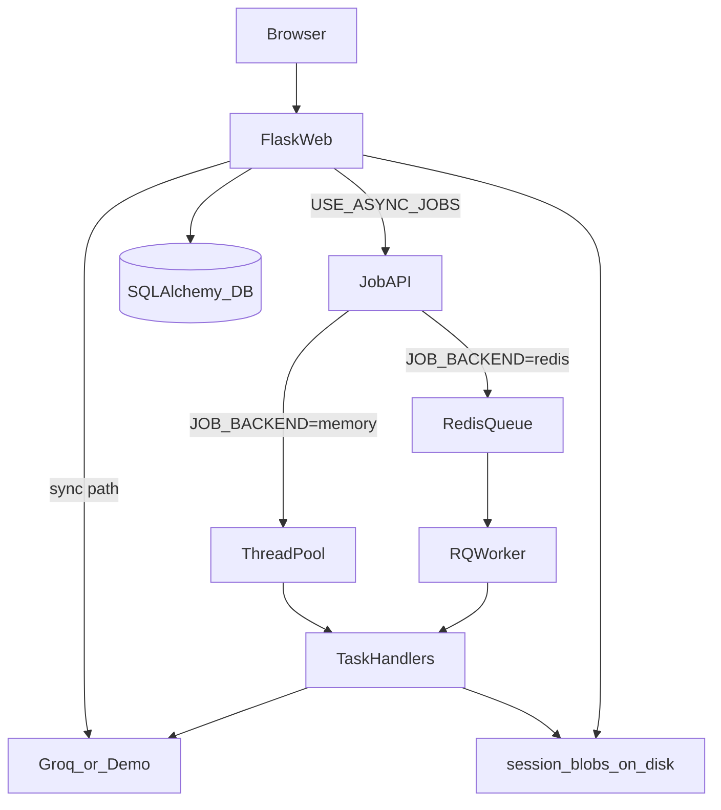

# Career AI — Architecture (interview talking script)

## One-sentence overview

Career AI is a Flask full-stack career toolkit: PDF resume + job description in, tailored docs / coaching / interview prep out — with SQL storage, embedding RAG, and an async job API designed to grow from laptop demo to Dockerized services.

## Request flow

1. Browser hits Jinja pages or JSON APIs.
2. Auth: JWT in `access_token` cookie (`utils/auth.py`).
3. Heavy LLM routes (coach, cover letter, email) can return **202 + job_id** when `USE_ASYNC_JOBS=true`.
4. Client polls `GET /jobs/<id>` until `done` / `failed` (`frontend/static/js/jobs.js`).

## Data model

| Table | Purpose |
|-------|---------|
| `users` | Auth identity (email unique, password hash) |
| `resumes` | Uploaded resume metadata per user |
| `job_searches` | JD-linked searches + ATS/readiness scores |
| `coach_queries` | Coach message log |
| `knowledge_chunks` | Cached RAG chunks + embedding JSON |

Feature flag `USE_DATABASE` switches repositories between JSON files and SQLAlchemy. Migration: `python -m utils.migrate_to_db`.

## RAG lifecycle

1. `build_knowledge_base` loads resume PDF, JD blob, optional profiles.
2. Text is chunked (`utils/rag.py`).
3. If `USE_EMBEDDINGS=true`, chunks get vectors (`hashing` or OpenAI-compatible API).
4. If DB + embeddings both on, chunks persist in `knowledge_chunks` keyed by `content_hash` (skip re-embed when unchanged).
5. Retrieve: cosine similarity (embeddings) or TF-IDF (default).

## Job lifecycle

| Status | Meaning |
|--------|---------|
| `queued` | Accepted, waiting for worker |
| `running` | Task handler executing |
| `done` | `result` payload available |
| `failed` | `error` string set |

- **memory**: `ThreadPoolExecutor` in-process (local / tests).
- **redis**: metadata in Redis hashes; RQ worker runs `utils.jobs.process_redis_job`.

Payloads are JSON-serializable dicts (`utils/job_tasks.py`) so Redis workers do not need Flask request context.

## Reliability surfaces

| Endpoint | Role |
|----------|------|
| `GET /health` | Liveness |
| `GET /ready` | DB ping when `USE_DATABASE` |
| `GET /metrics` | In-process counters (`jobs_queued`, `jobs_done`, `jobs_failed`, …) |

Every request gets `X-Request-ID` and structured latency logs (`utils/observability.py`).

## Failure modes (say this out loud)

- **LLM timeout / rate limit** → job `failed` or sync 500 with formatted error; demo mode avoids spend.
- **Redis down** → job manager falls back to memory (logged).
- **SQLite write contention** → migrate to Postgres via `DATABASE_URL` (compose default).
- **Process restart** → in-memory jobs lost; Redis-backed jobs survive worker bounce if Redis persists.
- **Cookie session size** → large payloads in `uploads/session_blobs/<store_id>/`.

## Trade-offs we chose

| Decision | Why |
|----------|-----|
| Feature flags | Ship storage/RAG/async without breaking the live path |
| SQLite default | Zero-setup local; Postgres in Docker for “real” deploy story |
| Hashing embeddings default | Offline tests + demo; swap `EMBEDDING_PROVIDER=api` for quality |
| RQ over Celery | Smaller surface, same interview signal (queue + worker) |
| Jinja not React | Full-stack signal without rewriting the product mid-interview prep |

## How I’d scale next (honest)

Rate limits per user, object storage for PDFs, pgvector or dedicated vector DB, gunicorn replicas behind a load balancer, and treat **LLM throughput/cost** as the primary bottleneck — not the user table.
